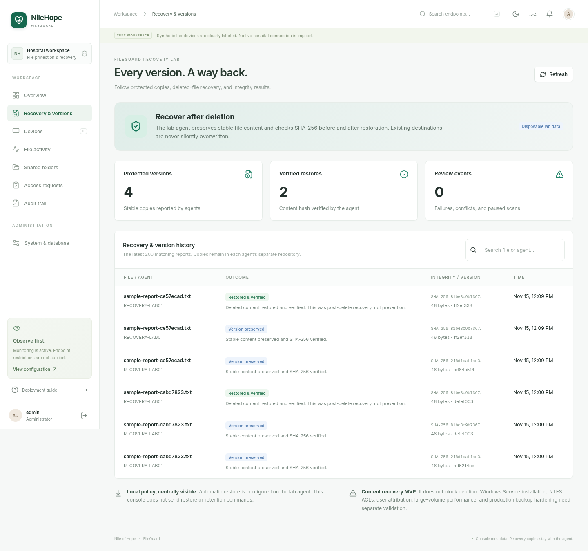

# NileHope FileGuard

File monitoring, version history, and **restore-after-delete recovery** for a controlled lab. React console, Python management/agent APIs, MySQL, Windows and Linux monitor agents, and a C#/.NET recovery worker.

The recovery worker preserves stable content in a separate repository, verifies SHA-256, and restores a deleted file when its local policy allows it. It never silently overwrites a same-name destination. This is post-delete recovery, not pre-delete blocking.

**Windows PC:** follow [local installation steps](docs/LOCAL-PC.md), then run `Start-Console-Only.bat`.



## Start the console locally

Requires Docker Engine with Linux containers and Compose v2. Windows PCs can use Docker Desktop/WSL 2.

```bash
python scripts/configure_stack.py
docker compose up -d --build --wait --wait-timeout 240
```

Open `http://localhost:8080` **on the machine running Docker**. The generated, ignored `.env` contains the console login and database credentials. On Windows, `Start-Local.bat` performs configuration and startup without host Python or Node; use `-SkipWindowsAgent` when starting only the console.

For clearly labeled synthetic monitoring data:

```bash
docker compose --profile demo up -d --wait
```

No hospital server, share, or directory integration is registered by default. Endpoint commands and directory writes are disabled. The console listens on loopback; HTTPS configuration is separate.

## Run the recovery lab

Requires the supported .NET 10 SDK. This script builds the C# agent, creates three disposable directories under `.local/recovery-lab/`, and starts the recovery worker in the foreground. It reads this installation's enrollment token from `.env`; tokens are not included in source.

```bash
python scripts/start_recovery_lab.py
```

Then, in another terminal:

```bash
python scripts/check_recovery_lab.py
```

The validation creates, edits, and deletes a disposable sample, verifies restored content and SHA-256, and writes `.local/recovery-lab/validation.json`. Open **Recovery & versions** to see actual agent reports. Ctrl+C stops the foreground agent. Linux validates the recovery logic; Windows Service installation and NTFS behavior require a Windows lab.

## Project layout

```text
apps/console/              React dashboard
services/management/app/   Flask console API, agent API, audit, worker
agents/windows-monitor/   PowerShell device/SMB metadata monitoring
agents/windows-recovery/  .NET Windows-Service-capable recovery worker
agents/linux/             System health and selected-folder monitoring
deploy/containers/        Frontend/proxy images and configuration
deploy/local/             Windows PC and optional LAN setup
deploy/windows/           Native deployment tools and sample profiles
scripts/                  Configuration, lab startup and browser checks
tests/                    Python APIs and C# recovery scenarios
docs/                     Product plan, decisions, test evidence, roadmap
```

The Python console, ingestion API, and background worker run as separate containers with separate roles. They share a Python package and database. The recovery agent runs on the protected host, outside the web containers.

## MySQL Workbench

On the Docker host, connect to `127.0.0.1:13306`, schema `nilehope_fileguard`, using the generated `.env` credentials. **System & database** shows connections, table counts, and a schema download. A PC cannot reach the cloud workspace's loopback address directly. See [Workbench guidance](docs/WORKBENCH.md).

## Validation

```bash
python -m pip install -r requirements.txt pytest ruff
python -m pytest -q
ruff check services tests deploy/windows
npm ci --prefix apps/console
npm run build --prefix apps/console
dotnet run --project tests/recovery-engine/FileGuard.Recovery.Tests.csproj -c Release
```

See [validation evidence](docs/VALIDATION.md), [accepted architecture](docs/ARCHITECTURE.md), and [remaining work](docs/ROADMAP.md).

## Scope and limits

- The lab preserves content and basic modification timestamps. NTFS ACLs, alternate streams, ownership, and clinical application consistency require separate work.
- Periodic complete scans reconcile watcher notifications. Recovery requires a previously captured stable copy. High event volume and downtime need Windows stress testing.
- Rename/move currently appear as a new path and a missing old path; auto-restore can recreate the old name. Directory recovery requires review.
- Links/reparse points are excluded. Path checks do not provide race-proof defense against a malicious local administrator.
- A local repository is suitable for this isolated lab, not ransomware resilience. Production needs hardened external storage and recovery drills.
- Retention deletion and remote restore commands are not implemented. Versions remain until reviewed cleanup; watch lab capacity.
- Central RBAC, responsible-user attribution, signed installers, USN Journal tracking, and production deployment are later phases.

The [original product plan](docs/PROJECT-PLAN.md) is proposal material. The accepted implementation retains React/Python/MySQL and adds the C# recovery agent. Its suggested stack and later phases are not claims of implemented behavior.
