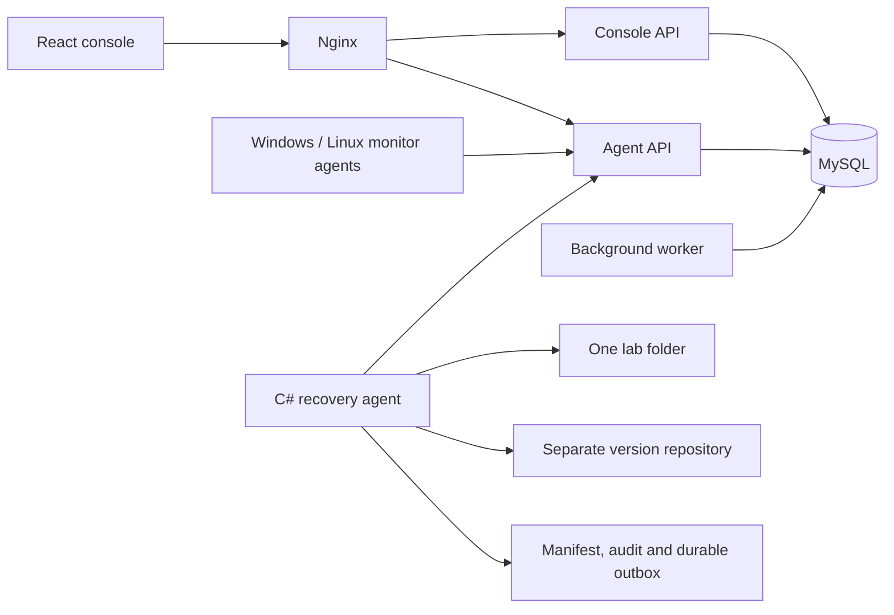

# Accepted architecture

Decisions: public source repository; cloud lab first; retain React/Python/MySQL and Windows/Linux monitoring; add .NET 10 recovery; restore after deletion in one disposable scope.

Sessions and CSRF guard console routes. Agents enroll with a deployment-specific token and receive individual keys; key hashes are stored on the server. Device-scoped recovery event IDs prevent duplicates. Only metadata crosses the API; contents remain in the agent repository.

The local scan/restore loop operates separately from reporting. During a management outage reports remain in a durable outbox; only acknowledged reports leave it. Restore requires an accessible complete scan, locally enabled policy, a verified copy, a safe existing parent, and an absent destination. Atomic no-overwrite promotion preserves conflicts. A persisted per-file rate limit suppresses repeated deletion loops.

Unreadable manifests fail visibly. Missing roots and incomplete scans pause recovery. An exclusive state lock prevents concurrent writers. Protected data, repository, and state must be separate directories.

| Endpoint | Purpose | Authentication |
|---|---|---|
| `POST /api/agent/enroll` | Device enrollment | Deployment token |
| `POST /api/agent/heartbeat` | Device health | Device key |
| `POST /api/agent/events` | Scoped monitoring metadata | Device key |
| `POST /api/agent/recovery-events` | Validated version/recovery metadata | Device key |
| `GET /api/console/recovery` | Searchable recovery history | Console session |

The separate console, ingestion, and worker containers share a Python package and database. They are not independently owned domain services. This prototype does not accept remote restore or retention commands.
