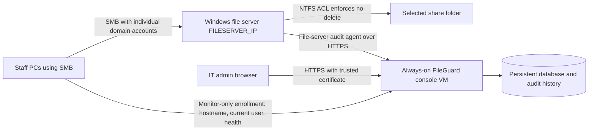

# Single file-server pilot with an always-on console VM

Scope: protect and monitor the Windows SMB file server at `FILESERVER_IP` first, and identify the supported PCs and signed-in users accessing it. Browser, USB, and clipboard blocking remain a later step on those user PCs. This guide is preparation only: it has not changed server permissions, audit policy, firewall rules, certificates, or the VM.

## The architecture



The Windows file server enforces deletion denial. The VM hosts the management console and receives audit data. The enforcement rule continues while the VM is offline; monitoring and alerts need the VM and agents to be online. The existing Windows agent advances its event-log cursor after the server acknowledges a batch, so a short console outage can be caught up from the Security log. If the outage lasts until records roll out of that log, events can be lost; size/forward the Security log for the expected outage and event rate. Staff PCs do not need a FileGuard agent for the SMB ACL to apply, but enrolling each supported PC is the best way to show its hostname and current user in the console. Without a PC agent, SMB audit can still provide the authenticated share user and client IP; the hostname then depends on DNS/DHCP mapping and may be ambiguous if IP addresses are reused.

## What the current project can and cannot show

The project already supports a Windows console VM installer, authenticated agent enrollment, a file-server agent role, exact share registration, an audit trail, and file recovery. Use [Windows VM deployment](WINDOWS_DEPLOYMENT.md) for the installer and HTTPS setup.

### Read-only discovery completed on 2026-11-17

- Server: record hostname, Windows version, domain, and address in the private operations runbook.
- Share: record the exact UNC name and local backing path in the private operations runbook.
- Review both share-level permissions and NTFS ACLs on a disposable copy before enforcement; effective access depends on both layers and child ACLs may differ.
- Confirm audit policy, SACL scope, Security log capacity, and retention before expanding collection.
- Treat active SMB sessions as a point-in-time view, not a complete historical inventory.
- Confirm whether the server monitoring agent is installed and record its service or task status.

These checks were read-only. No ACL, audit policy, share permission, agent, firewall, or VM configuration was changed.

The current file-server collector reads Event ID 5145 and forwards DELETE access checks for registered shares. That is not a complete record of every user's share activity. A 5145 failure means the share-level check denied access; it does not report NTFS-level denial. Before claiming all activity is monitored, the agent/backend needs an audit collector for the selected share's file-system events (including 4656 failures, 4663 successful rights use, and 4660 completed deletions) and must correlate those with SMB events for source IP and user session. To show the client device name safely, persist the device correlation at event time; do not guess from a DHCP address that may later belong to another PC. See the existing known limitation in [the broader pilot guide](DOMAIN-PILOT-NO-DELETE.md#troubleshooting).

If “monitor every action” includes every read/open, that is much higher volume than monitoring create, write, rename, and delete. Decide which actions must be visible and set retention before enabling broad success auditing.

Before full monitoring is claimed, the project needs three focused changes: (1) collect the selected share's 4656/4663/4660 file-system events in addition to 5145, (2) store the SMB user/session, event ID, access type, source IP, path, result, and event time in the audit record, and (3) correlate that event-time IP to an enrolled client hostname and persist the match so DHCP reuse cannot rewrite history. The current device list already receives endpoint hostnames and current users, but current share events are not durably linked to a client device.

## Phase 1: inventory the real share

On `FILESERVER_IP`, open elevated PowerShell and run only these read-only commands:

```powershell
hostname
Get-CimInstance Win32_ComputerSystem | Select-Object Name, Domain, PartOfDomain
Get-CimInstance Win32_OperatingSystem | Select-Object Caption, Version
Get-SmbShare | Where-Object { -not $_.Special } | Select-Object Name, Path
Get-SmbShareAccess -Name 'YOUR_SHARE_NAME'
Get-SmbSession | Select-Object ClientComputerName, ClientUserName, NumOpens, SecondsIdle
Get-SmbOpenFile | Select-Object ClientComputerName, ClientUserName, Path
```

The last two commands show devices/users connected at that moment; they are a live snapshot, not history. Record the server hostname, exact share name, local folder path, domain, and the existing staff/service/admin groups. FileGuard currently matches a registered share to the enrolled server hostname, so use a UNC path such as `\\FILE01\Department`, not the IP form. Keep patient/client file names and contents out of chat.

Confirm every person uses an individual domain account. If people connect through a shared account, the audit log can only identify that shared account, not the individual person.

List all supported client computers through the organization's AD computer inventory and DHCP/DNS records, then compare that list with the live SMB sessions. Some devices may be offline during the snapshot. Any SMB client can still be subject to the server ACL; for a durable computer name and current-user card in FileGuard, enroll each supported endpoint and correlate the activity event to that device at the time it occurred.

## Phase 2: prepare the console VM for continuous service

1. Use a dedicated VM on a host that stays powered on. Configure the hypervisor to start the VM automatically after host recovery, and configure the VM not to sleep.
2. Give the VM a reserved LAN IP and an internal DNS name, for example `fileguard.<your-internal-domain>`. The console URL is this VM name; it is separate from the file server address `FILESERVER_IP`.
3. Install the console with the existing [Windows VM deployment steps](WINDOWS_DEPLOYMENT.md). The Windows installer creates protected runtime configuration and startup/restart tasks for the web app, worker, and HTTPS proxy. For a production/hospital rollout, use a backed-up database and persistent storage; the deployment guide distinguishes the SQLite pilot from PostgreSQL use.
4. Serve the console over HTTPS with a certificate trusted by the VM, `FILESERVER_IP`, and IT admin computers. Prefer the organization's internal PKI and DNS name. Do not disable certificate validation.
5. Allow inbound HTTPS (TCP 443) to the VM only from the file server and approved IT/admin networks. Keep the app's loopback port and database port private. Do not publish the console to the public internet.
6. Configure VM, database, and application backups, disk/DB capacity alerts, and a tested restore procedure. A single VM improves uptime over a desktop PC but is still one failure point; a VM checkpoint alone is not a substitute for application-aware backups.

The current Windows deployment guide includes the exact installer command and certificate checks. It does not automatically choose the VM hostname, hospital CA, DNS, firewall scope, or database for your environment.

## Phase 3: connect the file server and enroll share-client PCs

After the console is running on the VM and HTTPS works from `FILESERVER_IP`, install the file-server agent on that server. Also enroll every supported Windows PC that accesses the share, using the workstation role. The workstation agent is for device identity and health in this phase; the server's NTFS ACL enforces no-delete.

From the prepared project/agent bundle on `FILESERVER_IP`, in elevated PowerShell:

```powershell
.\agents\windows-monitor\Install-LocalAgent.ps1 `
  -ServerUrl 'https://fileguard.YOUR-INTERNAL-DOMAIN' `
  -EnrollToken $enrollToken `
  -Role fileserver `
  -Ring pilot
```

Use the actual script location and the VM's HTTPS DNS name. Obtain the bootstrap token locally from the protected VM runtime; do not paste it into chat or put it in a public deployment bundle. The agent stores an individual device key under `%ProgramData%\FileControl` and runs as SYSTEM at startup. A healthy certificate alone does not authenticate the agent: the earlier HTTP 401 means the API rejected the device credentials/registration, so confirm each machine has successfully enrolled and is presenting its own device key.

For domain-joined Windows PCs, use the existing [GPO deployment steps](WINDOWS_DEPLOYMENT.md) to enroll the computers in each approved workstation OU. For one-off or non-domain Windows PCs, install the agent locally with `-Role workstation`. Restrict the GPO bundle (it contains an enrollment token) to the target computers and administrators. Keep remote commands and directory writes disabled for this monitoring phase. Devices without a supported FileGuard agent can still access the share under Windows ACLs; their SMB user/IP audit remains, but the console may not know a durable device hostname.

The SMB event records the account used to open/access the share. The endpoint heartbeat reports the PC hostname, IP, and current interactive user. If staff use shared Windows logins or shared SMB credentials, the system cannot reliably identify the individual person; use one named domain account per staff member. For shared workstations or terminal servers, use the account in the SMB event as the activity identity, not the console's single current-user heartbeat field.

In the console, register the one exact UNC share, such as `\\FILE01\Department`, associated with the file-server hostname. Registration configures monitoring scope only; it does not alter ACLs or enable audit policy.

## Phase 4: protect deletion on a disposable pilot share

Do not begin on the live share. First create a new empty test folder/share on the file server's data volume, such as `D:\FileGuardPilot` / `\\FILE01\FG-Pilot`, and make a file/content backup plus a record of the original share and NTFS ACLs.

1. Create a dedicated domain group for ordinary staff who must be unable to delete, such as `FC-Share-NoDelete`. Keep file-server administrators, backup/recovery identities, and application service accounts separate.
2. On the pilot SMB share, give the staff group only the share-level access it needs (normally Change); keep administrators at Full Control. Do not give ordinary staff Full Control.
3. On the pilot folder's NTFS security settings, grant only the needed create/read/write rights to the staff group. Remove delete rights and add a scoped Deny for **Delete** and **Delete subfolders and files** across the pilot tree. Preserve SYSTEM, Administrators, and required service access. Review creator/owner rights and any inherited or explicit child ACEs.
4. Check effective access for a real pilot user over the UNC path. Deleting or renaming can be permitted by either `DELETE` on the file or `DELETE_CHILD` on its parent, so verify both. Remote effective access also considers share and file-system permissions.
5. Test with a non-admin account: create and edit a disposable file, delete a file created by the same user, delete a file created by another user, rename/move a file, and save using the actual Office/clinical software. Ordinary deletes should fail. Some applications save by replacing or renaming files and may fail under a no-delete rule.
6. Keep the rule limited to ordinary staff. Server owners/admins can take ownership or change ACLs; ordinary NTFS permissions do not guarantee that an administrator can never delete data. Use a separate protected, versioned backup and break-glass process.

Microsoft documents that delete/rename requires `DELETE` on the file or `DELETE_CHILD` on the parent. Review [DeleteFile permissions](https://learn.microsoft.com/en-us/windows/win32/api/winbase/nf-winbase-deletefile), [remote SMB effective access](https://learn.microsoft.com/en-us/troubleshoot/windows-server/windows-security/access-checks-windows-apis-return-incorrect-results), and [file ownership/permission control](https://learn.microsoft.com/en-us/windows/security/threat-protection/security-policy-settings/take-ownership-of-files-or-other-objects).

## Phase 5: audit the selected share and prove monitoring

1. Enable Advanced Audit Policy **Audit File System** for the required success/failure events, then add a SACL only to the selected pilot folder and only for the actions you need. A matching SACL is required for file-system audit events; the event volume depends on the SACL.
2. For all detailed SMB file/folder access checks, Windows has **Audit Detailed File Share**, which emits Event 5145 without a per-share SACL. It can produce high event volume across the server, so do not enable success auditing indiscriminately on a server with other shares.
3. Verify denied NTFS delete attempts with 4656 failure and successful file-system operations with 4663; use 4660 for completed deletion correlation. Do not rely on 5145 failure alone: Microsoft says it only records denial at the SMB share permission level and emits no failure event for NTFS-level denial.
4. Check in the console that each event shows the domain user, server, exact path, operation/result, timestamp, source client IP, and a device name correlated from the enrolled PC at that event time. Test two separate user accounts from two clients. If account names are shared, attribution will not identify individuals.
5. Check Security log size/retention and event forwarding during the pilot. Monitor only the selected share first, then expand once volume and attribution are understood.

References: [Audit File System](https://learn.microsoft.com/windows/security/threat-protection/auditing/audit-file-system), [Event 4656](https://learn.microsoft.com/en-us/previous-versions/windows/it-pro/windows-10/security/threat-protection/auditing/event-4656), [Event 4663](https://learn.microsoft.com/en-us/previous-versions/windows/it-pro/windows-10/security/threat-protection/auditing/event-4663), and [Event 5145](https://learn.microsoft.com/en-us/previous-versions/windows/it-pro/windows-10/security/threat-protection/auditing/event-5145).

## Future endpoint DLP

Browser, USB, and clipboard blocking are later endpoint controls. To prevent a person from copying share content to a browser upload, USB drive, or local clipboard on their PC, install and manage those controls on every PC that needs coverage. The file server and console VM cannot inspect a user's local USB or clipboard. The workstation agents installed in Phase 3 provide device inventory/health; they do not yet enforce those later DLP controls.
