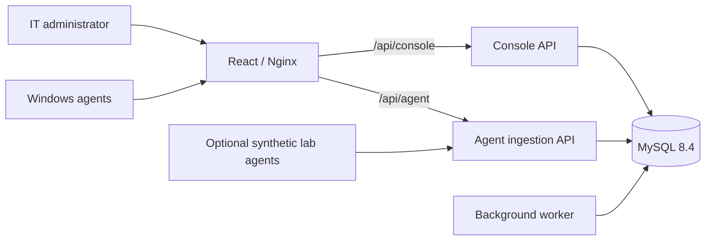

> Earlier monitoring deployment reference. The root README and ARCHITECTURE.md define the current FileGuard scope. Recovery is configured separately in its disposable lab.

# Containerized File Control Center

The new frontend is a React/TypeScript application served by Nginx. It talks to authenticated Flask APIs through the same origin. The console API, agent ingestion API, expiry/heartbeat worker, and MySQL database run in separate containers. An initialization job creates the fresh schema and first administrator without resetting existing data.



The services share the application database and can be operated independently. This is a practical service split; it does not claim independent databases for each business domain. The frontend container cannot directly reach the database network.

## Run a local test

Requirements: a Linux Docker Engine with Compose v2, Python 3.11+ for configuration generation, and sufficient disk space for MySQL and the frontend build. The frontend Dockerfile builds its React bundle with Node; Node does not have to be installed on the host for the standard container build.

From the extracted project:

```sh
python scripts/configure_stack.py
docker compose --profile demo up -d --build
docker compose --profile demo ps
```

Open **http://127.0.0.1:8080** on the Docker host. The administrator username and randomly generated password are in `.env` as `BOOTSTRAP_ADMIN_USER` and `BOOTSTRAP_ADMIN_PASSWORD`. The generator refuses to overwrite an existing `.env`.

The default test mode applies no endpoint restrictions and makes no AD membership changes. It registers `\\EXAMPLE-FILE01\E` as a target but does not contact it. The optional `demo` profile creates clearly labelled `SIM-*` lab agents and training access-check metadata. Its three online agents send genuine API heartbeats; one additional lab device is deliberately offline. They do not run Windows commands or connect to hospital computers.

To run without synthetic devices, omit `--profile demo` on a fresh test database. Existing demo rows remain in an already seeded database; omitting the profile does not delete them. Do not clear a populated hospital database merely to remove examples.

The `initialize` container exits successfully after setup; it is not a long-running service. `frontend`, `backend`, `agent-api`, `database`, and `worker` have health checks. `lab-agents` is optional.

## Use the UI

- **Overview:** connection metrics, actual seven-day stored observations, endpoint state, and recent activity.
- **Devices:** search/filter, detail dialog, deployment-ring changes, and command history. Restriction dispatch is off during connection testing.
- **File activity:** result filters, path/user/device search, pagination, and authenticated CSV export.
- **Shared folders:** exact UNC registration/removal. These actions affect monitoring scope, not Windows ACLs.
- **Access requests:** administrator-entered records and review; live grants remain disabled until real LDAPS integration is configured.
- **Audit trail:** searchable activity with hash-chain verification.
- **System & database:** console/agent/database/worker status, table counts, native MySQL schema download, and saved approval-duration preferences.
- Responsive navigation, keyboard-accessible dialogs, persistent light/dark themes, and Arabic right-to-left layout are included. Some diagnostic and installation terminology remains English.

If a connection fails, the UI labels retained data as the last received data while reconnecting. An online agent is one with a heartbeat in the last 90 seconds. ACL observations never assert effective protection.

## MySQL Workbench

For the local test:

| Field | Value |
| --- | --- |
| Method | Standard TCP/IP |
| Host | 127.0.0.1 on the Docker host |
| Port | 13306 |
| Database | nilehope_fileguard |
| User | MYSQL_USER in .env |
| Password | MYSQL_PASSWORD in .env |

Port 13306 avoids taking over an existing MySQL service on port 3306. The default publication is loopback-only. When Workbench runs on another PC, configure the actual Docker host's hospital-network interface and scoped inbound rule; use that host's address from Workbench. Do not assume the cloud preview is reachable at the hospital VM address.

Download the table definitions from **System & database → SQL schema**. The browser only receives safe device metadata and aggregate table counts; database passwords, admin password hashes, and device API-key hashes are not exposed.

## Windows Server 2025 deployment

These are Linux containers. The Windows VM `EXAMPLE-FILE01` needs a supported Linux container runtime, such as Docker Engine in a Linux VM hosted by Hyper-V, or an approved separate Linux Docker host. Docker Desktop is not a supported Windows Server installation route. Nested virtualization and resource availability must be checked before choosing a VM-inside-VM setup.

The selected route is now a separate existing Linux Docker host. Its address and SSH access are still required before remote deployment.

An existing native application was indicated by `C:\FileControlCenter\fcc`. Inspect and back it up before replacing its endpoint or database. The container test does not change that application, its services, or its ports.

On the prepared Linux host, `compose.production.yml` adds an HTTPS gateway, secure cookies, and the hospital environment marker:

```sh
docker compose -f docker-compose.yml -f compose.production.yml up -d --build
```

Set `DLP_HOSTNAME=fileguard.example.local` and `TLS_BIND_ADDRESS` to the correct local hospital interface only after DNS/network routing is established. The included Caddy profile uses an internal CA for an intranet pilot. Distribute only its public root certificate through the hospital trust policy, or replace the TLS configuration with the hospital PKI certificate. Keep the CA private key protected.

If the DNS name continues to resolve to the Windows file server while containers run on a different Linux VM, configure the Windows reverse proxy to forward to that Linux host. Do not bind the Linux container to an IP address owned by a different VM. In that arrangement, keep production cookies secure and use the trusted HTTPS hostname for agents.

The production override omits the demo profile. Enabling AD approvals or endpoint commands is a later configuration change after live validation; the initial test deliberately leaves both flags off. The original approval model uses action-wide AD groups and still requires a per-file authorization design if grants must be limited to individual paths.

## Operations

```sh
docker compose logs -f backend agent-api worker
docker compose stop
# Starts the existing stack again; keeps persistent MySQL and agent-key volumes.
docker compose --profile demo up -d
```

Back up MySQL and protected runtime configuration using the hospital's backup process. Do not use `down -v` against a database you need to retain. Image upgrades are not database migrations; back up and review existing schemas before changing versions. `.env` and lab key files must not be committed or uploaded.

## Verification

```sh
python -m pip install -r requirements.txt pytest ruff
python -m pytest -q
ruff check app tests deployment scripts
# Optional browser suite, against this synthetic test stack only:
python -m pip install playwright
CHROMIUM_PATH=/path/to/chromium python scripts/test_ui.py
```

`TEST_DATABASE_URL` must point at a dedicated disposable test database; the unit tests clear its application tables. The browser suite refuses to mutate a non-test environment. It reads login credentials from local `.env` and writes its screenshots/report to a scratch output directory.

The cloud test host uses a VFS storage driver and a small disk. Its actual run used a flattened image assembled from hash-verified upstream MySQL 8.4 layers, the same application code in a slim backend image, a frontend container built from the verified React production bundle, and a temporary CA-secret mount for the workspace's outbound TLS proxy. These are test-environment accommodations. The distributable Compose file uses the upstream MySQL image and the full frontend build recipe.
